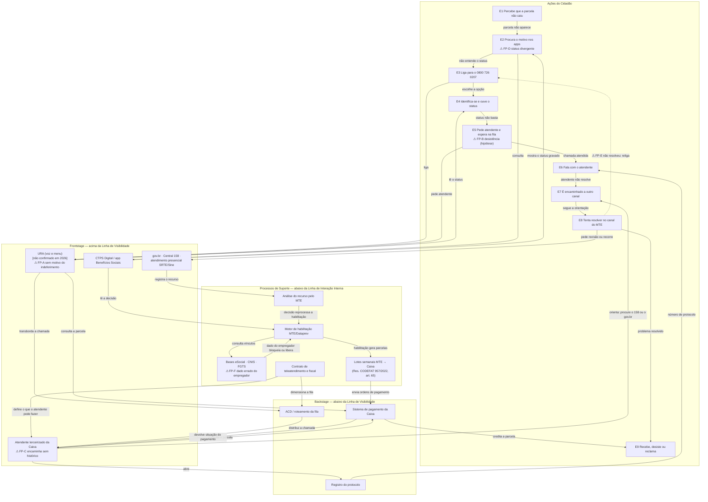

# D — Diagrama da jornada AS-IS

O diagrama traz a jornada decidida no `/grill-me` (`C_grill_transcript.md`) e detalhada em `C_blueprint_asis.md`. São 9 etapas, com as camadas separadas pelas três linhas do blueprint e os 6 fail points (⚠). **Cada seta tem um rótulo** que diz o que passa de um ator ao outro: pedido, dado, transferência ou decisão. A seta de retorno E8 → E3 (FP-E) vem da decisão D2 do aluno: a jornada só termina com a solução.

## 1. Fluxo da jornada com os atores

## 2. Quem passa o quê a quem (handoffs entre atores)

| De | Para | O que passa | Etapa | Fail point |
|---|---|---|---|---|
| Cidadão | CTPS Digital / app Benefícios Sociais | Consulta do status | E2 | FP-D |
| Cidadão | URA | Ligação e CPF/NIS | E3–E4 | FP-A |
| URA | Sistema de pagamento da Caixa | Consulta da parcela [não confirmado em 2026] | E4 | FP-D |
| URA | ACD / roteamento da fila | Transbordo para atendente | E5 | FP-B |
| ACD | Atendente terceirizado | Distribuição da chamada | E5–E6 | — |
| Atendente | Sistema de pagamento da Caixa | Consulta da situação do pagamento | E6 | — |
| Atendente | Registro do protocolo | Abertura do protocolo | E6 | FP-C |
| Atendente | Cidadão | Orientação "procure o 158 ou o gov.br" | E7 | FP-C |
| Cidadão | gov.br / Central 158 / SRTE ou Sine | Pedido de revisão ou recurso | E8 | FP-E |
| gov.br / SRTE ou Sine | Análise do recurso pelo MTE | Recurso registrado | E8 | — |
| Análise do recurso | Motor de habilitação MTE/Dataprev | Decisão que reprocessa | E8 | — |
| Bases eSocial/CNIS/FGTS | Motor de habilitação | Dado de vínculo do empregador | Suporte | FP-F |
| Motor de habilitação | Lotes semanais MTE → Caixa | Parcelas habilitadas | Suporte | — |
| Lotes semanais | Sistema de pagamento da Caixa | Ordens de pagamento | Suporte | FP-D (causa: "pago" antes do crédito) |
| Sistema de pagamento da Caixa | Cidadão | Crédito na conta | E9 | — |
| Contrato de teleatendimento e fiscal | ACD e atendente | Dimensionamento da fila e escopo do atendimento | Suporte | FP-B |

## Como ler

- **Setas sólidas com rótulo:** o caminho normal e cada passagem entre atores.
- **Seta tracejada E8 → E3 (FP-E):** a peregrinação. Quando o canal do MTE não resolve, o cidadão volta a ligar para a URA.
- **⚠:** os 6 fail points decididos na Rodada 4 (D7) e ajustados na Rodada 7 (D13, D14).
