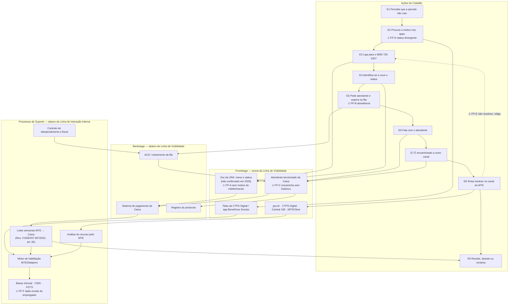

# D — Diagrama da jornada AS-IS

O diagrama traz a jornada decidida no `/grill-me` (`C_grill_transcript.md`) e detalhada em `C_blueprint_asis.md`. São 9 etapas, com as camadas separadas pelas três linhas do blueprint e os 6 fail points (⚠). A seta de retorno E8 → E3 (FP-E) vem da decisão D2 do aluno: a jornada só termina com a solução.

## Como ler

- **Setas sólidas:** o caminho normal e as dependências. Cada ação do cidadão aciona um ponto do frontstage. O frontstage depende do backstage, e o backstage depende dos processos de suporte.
- **Seta tracejada E8 → E3 (FP-E):** a peregrinação. Quando o canal do MTE não resolve, o cidadão volta a ligar para a URA.
- **⚠:** os 6 fail points decididos na Rodada 4 (D7).
